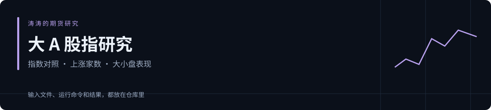

[English](README.md) · [简体中文](README.zh-CN.md)



# 大 A 股指研究

我把四个指数的表现和成分样本分开检查：指数涨多少，上涨家数有多少，大小盘谁领先，各自要看对应的数据。

[涛涛的期货研究](https://github.com/Serennity007/taotao-futures-research) · [Skill 指令](SKILL.md) · MIT

## 跑一次练习

准备 Python 3.10 及以上版本，脚本只用标准库：

```bash
git clone https://github.com/Serennity007/a-share-index-research-skill.git
cd a-share-index-research-skill
python scripts/run_research.py --config examples/workbench.json --out output
```

打开终端打印的 `REPORT.html`。想先看结果，可以打开 [文字报告](examples/workbench/REPORT.md)，或下载 [HTML 报告](examples/workbench/REPORT.html) 后用浏览器查看。

仓库自带的 CSV 是模拟数据，日期是练习标签。这组练习可以核对计算和步骤，不能作为历史交易记录。

## 对照结果看数据

四指数样例从100出发，沪深300末值102、中证1000末值104，分别涨2%和4%。收益差是2个百分点，相对比变化约1.9608%。

宽度样例只提供6只，完整范围声明为10只，覆盖率60%；3涨、2跌、1平，上涨比例50%。读报告时先记缺了4只，再判断样本表现。

IF、IH、IC、IM 分别对应沪深300、上证50、中证500、中证1000。练习里的指数价格和成分数据都是模拟输入；讨论具体期货时，还要核对月份和同期现货。[方法说明](references/method.md) 列了这些区别。

## 换自己的数据

复制 `examples/workbench.json`，修改标的、截止时间和文件位置。导入数据时，将 `data_kind` 改成 `imported_observations`，给每个文件填写来源名称和取数时间。[输入字段与配置](references/workbench.md) 有说明，旧的单项计算命令也保留在里面。

程序把 CSV 的相对路径按配置文件位置解析。若从其他目录运行，使用脚本和配置的绝对路径。

## 保存和复盘

每次运行会新建 `output/run-…/`。`REPORT.md` 放文字结果，`bundle.json` 放计算明细，`inputs/` 保存本次使用的文件。

在本仓库用旧报告的配置重跑：

```bash
python scripts/run_research.py --config 旧报告目录/config.snapshot.json --out output
```

把“旧报告目录”换成实际路径。输入相同，计算结果应一致。复盘时保留旧报告，再用新数据另跑一份，对照原来等的条件有没有发生。[记录格式](references/report-template.md) 可作参考。

## 作为 Skill 使用

把整个仓库放进你使用工具的技能目录，保留文件夹名 `a-share-index-research-skill`。调用时写清数据位置、标的和截止时间：

```text
使用 $a-share-index-research-skill，读取我提供的……，截止时间为……。
运行计算，说明已经观察到什么、还有什么要查，保存报告。
```

## 检查计算

```bash
python -m unittest discover -s tests -v
```

当前有 27 项本地测试，检查计算、时间截止和文件读写。实际数据的来源、单位与历史版本仍需要你核对。[官方资料入口](references/sources.md) 放在这里。

K 线计算沿用我在 [选股工具合集](https://github.com/Serennity007/awesome-stock-quant-skills/tree/67156b0aa4860894a8cdbc66b797db535531fe59/my-skills/gold-cross-asset-research) 中整理的脚本，本仓库附有自身代码与测试。
